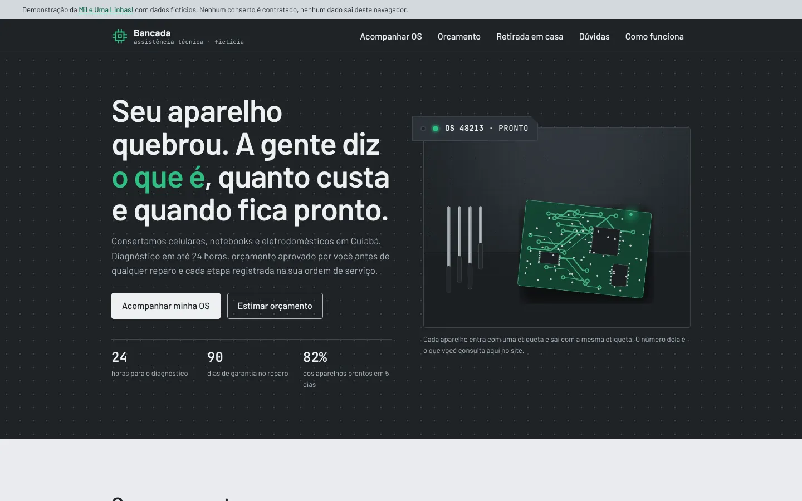

# Bancada Assistência Técnica (site de demonstração)

Eu sou o Rodrigo Jr, da [Mil e Uma Linhas!](https://mileumalinhas.com.br). Este é um site de demonstração que fiz para mostrar a uma assistência técnica (conserto de celulares, notebooks e eletrodomésticos) como pode ser o site dela: bonito, com identidade própria e, principalmente, útil para o cliente que deixou o aparelho na oficina.

**Tudo aqui é fictício.** A oficina "Bancada" não existe. Os técnicos, o endereço, o telefone, as ordens de serviço, os preços e os prazos foram inventados por mim. Nada é vendido, cobrado ou enviado. Você pode mexer em tudo sem medo.

Endereço publicado: https://toshiro01001.github.io/assistencia-tecnica/

## O que o site faz

Para quem não é da área: é a página de uma oficina de conserto onde você consegue, sozinho, fazer quatro coisas.

1. **Acompanhar a ordem de serviço (OS).** Digita o número da etiqueta e vê a linha do tempo do conserto: recebido, diagnóstico, aguardando peça, em reparo, pronto. Com a nota do técnico em cada etapa, a previsão de entrega e o nome de quem está cuidando.
2. **Estimar o orçamento.** Escolhe o aparelho (celular, tablet, notebook, máquina de lavar, geladeira, micro-ondas, TV), o defeito, o porte e a urgência, e vê a faixa de preço e o prazo antes de sair de casa.
3. **Agendar retirada, entrega ou visita técnica.** Marca o dia (sete próximos dias úteis), a janela de horário (as já ocupadas aparecem riscadas), preenche nome, telefone e endereço e recebe um resumo com protocolo.
4. **Tirar dúvidas com busca.** Digita uma palavra e a lista de perguntas filtra na hora, sem diferenciar acento ou maiúscula.

## Como usar, passo a passo

1. Abra o site. No alto fica a faixa dizendo que é demonstração.
2. Role até **Acompanhe a sua ordem de serviço** e clique numa das quatro etiquetas de exemplo (`BK-48213` pronto, `BK-48210` em reparo, `BK-48199` aguardando peça, `BK-48221` recebido hoje). Ou digite um deles no campo. Digite um número que não existe para ver a mensagem de "não achei".
3. Em **Estime o orçamento**, escolha "Notebook" e "Esquenta e desliga". Troque o porte e a prioridade e veja a faixa mudar. Escolha "Televisão" e "Linhas ou manchas na tela" para ver o caso em que a oficina diz que não compensa.
4. Em **Retirada e entrega em casa**, clique num dia, numa janela, preencha os dados e confirme. Clique em "Confirmar" com tudo vazio para ver a validação.
5. Em **Dúvidas frequentes**, digite "garantia", "backup" ou "molhou".
6. No fim, a seção **Como este site funciona** explica para leigos e, no "Detalhes técnicos", para quem programa.

## Capturas

Computador (1280 x 900):



Celular (iPhone 13):


Funções: [acompanhamento de OS](docs/funcao-os.webp) ([celular](docs/funcao-os-celular.webp)), [orçamento](docs/funcao-orcamento.webp) ([celular](docs/funcao-orcamento-celular.webp)), [agendamento](docs/funcao-agendamento.webp) ([celular](docs/funcao-agendamento-celular.webp)), [resumo do agendamento](docs/funcao-agendamento-resumo.webp) ([celular](docs/funcao-agendamento-resumo-celular.webp)), [dúvidas com busca](docs/funcao-duvidas.webp) ([celular](docs/funcao-duvidas-celular.webp)).

## Identidade visual, em resumo

O estudo completo está em [`docs/identidade.md`](docs/identidade.md).

- **Nome e frase:** Bancada Assistência Técnica. "A gente diz o que é, quanto custa e quando fica pronto."
- **Ideia:** a bancada do técnico, limpa e organizada, e a etiqueta de OS amarrada no aparelho. A etiqueta (retângulo chumbo com furo e número em fonte mono) é o elemento gráfico que se repete.
- **Paleta:** Chumbo `#1F2327` (fundos escuros e texto), Chumbo claro `#2C3238` (superfícies no escuro), Bancada `#E9ECEF` e Inox `#D3D8DE` (fundos claros), Grafite `#4F5A66` (texto de apoio), Verde-circuito `#2FBF83` (o LED, uma vez por tela) e Verde-placa `#0F6B47` (links sobre fundo claro). Fugi do azul-e-laranja de assistência de shopping e do azul-gelo que já usei no site de ar-condicionado.
- **Fontes:** Barlow (texto, inspiração DIN de manual de serviço) e JetBrains Mono (todos os números: OS, datas, preços, prazos). Ambas locais, licença SIL OFL 1.1, na pasta `fonts/`.
- **Movimento:** abertura em blur-up (cada parte do hero sobe 30px e sai do desfoque em 800ms, em escada), os números do hero contam até o valor, cada seção entra uma vez ao aparecer na rolagem, as notas do técnico são digitadas no terminal da OS e as colunas da OS crescem. Com "reduzir movimento" ativado no sistema, nada se mexe e tudo aparece pronto.
- **Foto do hero:** `img/hero.webp` é uma foto gerada por IA no Canva (1440x1080), feita a partir do prompt da seção "Foto do hero" de `docs/identidade.md`.
- **Design systems (leva final):** a aparência segue dois sistemas de referência, developer-monetizati (blocos escuros: pílula de navegação com blur, selo com halo, terminal digitado, contador, cartões de métrica) e futureui (blocos claros: placa encaixada na faixa Chumbo, tiles que invertem no hover, calendário de células, gráfico de colunas, botões com degradê e véu). A seção "Design systems aplicados (leva final)" de `docs/identidade.md` lista componente por componente.

## Fotos

Todas as fotos em `img/` são **geradas por IA no Canva** e **ilustrativas**: não mostram uma oficina, um técnico ou um cliente de verdade. Os prompts estão em `docs/identidade.md`.

| Arquivo | Onde aparece | Proporção e tamanho |
|---|---|---|
| `img/hero.webp` | hero | 4:3, 1440x1080 |
| `img/servico-celular-placa.webp` | tile "Celulares e tablets" | 1:1, 1024x1024 |
| `img/servico-notebook-aberto.webp` | tile "Notebooks e computadores" | 1:1, 1024x1024 |
| `img/servico-lavadora-placa.webp` | tile "Eletrodomésticos" | 1:1, 1024x1024 |
| `img/prateleira-aparelhos-etiquetados.webp` | coluna do resultado da OS, antes da consulta | 16:9, 1456x816 |
| `img/oficina-bancadas.webp` | seção "A oficina", acima dos números | 3:2, 1456x970 |
| `img/tecnico-lupa.webp` | seção "A oficina", ao lado dos dados | 3:4, 1088x1456 |
| `img/caixa-transporte-retirada.webp` | coluna lateral de "Retirada e entrega", antes do agendamento | 4:3, 1456x1088 |

Enquanto a versão do Canva não é colocada, os sete arquivos novos são placas lisas em Chumbo claro, no tamanho certo, só para segurar o lugar.

## Como funciona por dentro

É uma página só. O navegador baixa o HTML, o CSS, o JavaScript, as fontes e a imagem, e pronto: não fala mais com nenhum servidor.

- As quatro ordens de serviço de exemplo, a tabela de preços e as janelas ocupadas estão escritas dentro de `js/site.js`. As datas são calculadas a partir do dia em que você abre o site, para os exemplos parecerem sempre atuais.
- A consulta de OS procura o código na lista e monta a linha do tempo na tela.
- O orçamento multiplica uma faixa base de peça pelo porte do aparelho, soma a mão de obra e aplica 25% a mais se for prioridade (e divide o prazo por dois).
- O agendamento valida os campos, formata o telefone e mostra o resumo. Nada é enviado.
- A busca de dúvidas compara o que você digitou com o texto de cada pergunta e resposta, sem acento e sem maiúscula.
- Só o "lembrar este número" grava algo no seu navegador (chave `bancada-os` no localStorage), e só se você marcar a caixa. Desmarcar apaga.

## Detalhes técnicos

- HTML, CSS e JavaScript puros. Sem framework, sem CDN, sem fonte externa, sem analytics.
- `Content-Security-Policy` por meta: `default-src 'self'; script-src 'self'; style-src 'self'; img-src 'self' data:; font-src 'self'; connect-src 'none'; object-src 'none'; base-uri 'self'; form-action 'none'`. Nenhum script ou estilo inline. O `data:` em `img-src` é só para as setinhas dos `<select>`, embutidas no CSS.
- Estado da interface em `aria-pressed`, `hidden`, `disabled` e classes. A barra de progresso usa classes `p1` a `p5` em vez de largura inline.
- Acessibilidade: `lang="pt-BR"`, link "pular para o conteúdo", foco visível, botões de verdade para dias e janelas, regiões `aria-live` nos resultados, contraste AA em todos os pares (a maioria AAA), `prefers-reduced-motion` respeitado.
- `404.html` com caminhos absolutos `/assistencia-tecnica/...`, `robots.txt`, `sitemap.xml`, `favicon.svg` e o arquivo de verificação do Search Console.

Organização dos arquivos:

```
index.html              a página
404.html                página de erro do GitHub Pages
css/estilo.css          toda a folha de estilo
js/site.js              as quatro funções e os dados de exemplo
fonts/                  Barlow e JetBrains Mono (woff2) com licenças
img/*.webp              fotos (geradas por IA no Canva, ilustrativas)
docs/identidade.md      estudo de identidade visual e prompt da foto
docs/vistoria.md        vistoria de segurança
docs/*.webp             capturas
tests/site.cjs          testes com Playwright
```

## Como rodar no seu computador

1. Baixe a pasta.
2. Na pasta **de cima** (a que contém `assistencia-tecnica/`), rode `python3 -m http.server 8315`.
3. Abra `http://localhost:8315/assistencia-tecnica/` no navegador.

Servir a pasta de cima faz os caminhos absolutos do `404.html` funcionarem como no GitHub Pages. Abrir o `index.html` com dois cliques também funciona para a maior parte, mas as fontes podem não carregar por restrição do navegador.

## Testes

`tests/site.cjs` usa Playwright e roda em três telas: 1280 x 900, iPhone 13 e 320px de largura. Em cada uma, confere console sem erros, ausência de rolagem horizontal, textos sem corte e cada função de ponta a ponta (consulta de OS válida, inválida e inexistente, localStorage ligando e desligando, cálculo do orçamento com porte e prioridade, caso sem conserto, validação e resumo do agendamento, janelas ocupadas, busca de dúvidas com e sem acento, página 404).

```
cd .. && python3 -m http.server 8315 &
cd assistencia-tecnica
node tests/site.cjs            # só verifica
node tests/site.cjs capturas   # verifica e salva capturas em tests/capturas/
```

Último resultado: tudo passou nas três telas, sem erro de console, sem rolagem horizontal, sem texto cortado.

## Segurança

Resumo da [`docs/vistoria.md`](docs/vistoria.md): CSP restritiva, nenhum envio de dados, nenhuma dependência, só uma chave opcional no localStorage, nenhum dado real no repositório. Risco residual: no GitHub Pages a CSP vai por meta e não por cabeçalho HTTP.

## Quem fez

Mil e Uma Linhas!, Cuiabá. Sites e sistemas para empresas: https://mileumalinhas.com.br
